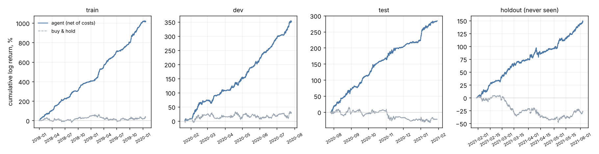

# drl-trading-agent

A deep reinforcement learning trading system built end to end: raw data → cleaning → cost model →
features → environment → actor-critic agent (PPO) → out-of-sample backtest → go-live checklist →
ensemble weighting.

I built this agent based on the inputs from the Coursera course [Reinforcement Learning for Trading Strategies](https://www.coursera.org/learn/trading-strategies-reinforcement-learning) (New York Institute of Finance and Google Cloud), part of the Machine Learning for Trading Specialization. Sections 2 and 3 below map the course's development steps and go-live checks to the code.


*Demo on a synthetic market. Solid: agent net of costs; dashed: buy & hold. Validates the pipeline, not a strategy.*

## Quick start

```
git clone https://github.com/anhvotn/DRL-trading-agent.git
cd DRL-trading-agent
pip install -r requirements.txt

pytest -q                                                         # 10 tests, ~20 s
jupyter notebook notebooks/walkthrough.ipynb                      # guided run, ~1-2 min
python -m drl_trader.run --demo                                   # full demo, ~5 min on CPU
python -m drl_trader.run --csv spy_15m.csv --ppy 6552             # your data
python -m drl_trader.run --csv spy_15m.csv --transfer-csv qqq_15m.csv --ppy 6552 --windows 20,40,80 --seeds 3
```

## Getting real data from Interactive Brokers

With TWS running (paper login is fine, API enabled under File > Global Configuration > API > Settings):

```
pip install ib_async
python ib_test.py                                   # checks the connection
python download_ib_history.py --years 16            # SPY 15-min bars -> data/spy_15m.csv
python download_ib_history.py --years 16 --with-spread   # adds bid/ask for the slippage model
python -m drl_trader.run --csv data/spy_15m.csv --ppy 6552
```

The downloader saves after every week of data, so it can be stopped with Ctrl+C and resumed by
running the same command. Downloaded data stays out of git (see `.gitignore`).

## Repository layout

```
drl_trader/
  data.py        loading, cleaning, cost model, features, splits, regime labels
  env.py         Gymnasium trading environment (buy / sell / hold, PnL and Sharpe rewards)
  agent.py       GRU encoders per data type + PPO actor-critic, two-stage training, fine-tuning
  evaluate.py    fast backtest, metrics, regime breakdown, go-live checklist, ensemble weights
  run.py         command-line pipeline
  synthetic.py   regime-switching synthetic market for testing
notebooks/walkthrough.ipynb   one full run with outputs
tests/test_pipeline.py        look-ahead, cost, split and backtest-consistency tests
assets/                       demo chart and demo outputs
```

## Tests

The tests target the bugs that make a backtest look better than it is:
features must not change when future data is removed, gaps are filled only from the past,
splits are chronological, normalisation uses training statistics only, the reward uses the
*next* bar's return, costs are charged exactly when the position changes, and the fast
batched backtest matches a step-by-step simulation.

## Data format

CSV columns: `timestamp, open, high, low, close, volume` plus, if you have them, `bid, ask` (better
slippage) and any `sentiment*` columns (e.g. a daily Fed-press-conference sentiment score,
forward-filled to the bar frequency **using only information published before the bar**).
`--ppy` = bars per year (daily 252, hourly US equities ≈ 1638, 15-min ≈ 6552).

---

## 1. System architecture

```
 market data ─┐                                   ┌─► order (buy / sell / hold)
              ├─► GRU encoder (price/volume) ─┐   │      │
 sentiment  ──┴─► GRU encoder (sentiment)   ──┼─► actor-critic policy (PPO) = "command center"
                                  position ───┘          │
                                                         ▼
                       net PnL (after spread + slippage) ─► reward ─► policy optimisation
```

| Course component | Where |
|---|---|
| RL trader / command center that chooses buy, sell or hold | `env.py` (`HOLD, BUY, SELL`) + PPO policy in `agent.py` |
| Deep recurrent network (DRNN) feeding the trader | `SplitGRUExtractor` in `agent.py` |
| Separate networks per data type, not one blended network | one GRU per input group (price vs sentiment) |
| Actor-based methods work best | PPO (actor-critic) |
| Window of data, experiment, reward/punish | `TradingEnv` random-start episodes over a sliding window |
| PnL first, Sharpe in later stages | stage 1 `reward="pnl"`, stage 2 `reward="sharpe"` (differential Sharpe ratio) with lower LR |
| Policy optimisation loop with new market data | `fine_tune()`; re-run on rolling windows |

## 2. Development steps (course part 2) → code

1. **Data quantity** – `check_data_size()` warns below 100k rows. Daily data gives ~5k rows per 20 years,
   so this guideline effectively means intraday bars (15-min SPY ≈ 6.5k rows/year → 15+ years).
2. **Market & risk choice** – FX < equities < crypto in risk; leverage scales all of it. Start with a
   liquid instrument (SPY/ES) so the impact model stays honest.
3. **Slippage / market impact** – `estimate_costs()`: half bid-ask spread + square-root impact
   `k·σ·√(trade size / volume)`; it falls back to an estimate from size, volume and volatility when
   there is no bid/ask data. The checklist re-runs the holdout at **2× costs**.
4. **Cleaning** – `clean()`: drop periods with too much missing data, fill short gaps.
   ⚠️ The course says "interpolated means". Linear interpolation uses the *next* price, which is
   look-ahead bias in a backtest, so the default here is forward-fill (`fill="interpolate"` still available).
5. **Many algos, weight the recent winners** – `--windows` × `--seeds` trains different agents;
   `ensemble_weights()` gives softmax weights by recent (dev) Sharpe, zero weight to any agent with Sharpe ≤ 0.
6. **Numeric + sentiment data** – separate encoders, as the course recommends.
7. **Out-of-sample backtesting** – chronological train 60 / dev 15 / test 15 / **holdout 10** (most
   recent, untouched until the end). Normalisation is fitted on train only.
8. **Representative regimes** – `label_regimes()` tags up / down / steady / volatile; metrics are reported per regime.
9. **Survivorship & corporate actions** – use split/dividend-adjusted prices; for multi-stock
   universes include delisted names (CRSP, Norgate, etc.).

## 3. Go-live checks (course part 3) → `go_live_checklist()`

| Check | Pass rule |
|---|---|
| Long history, different conditions | no regime with Sharpe < −0.5 out of sample; all four regimes present |
| Works on an untrained security at the same timestep | `--transfer-csv` Sharpe > 0 |
| Decent train, dev **and** test | `diagnose()` → OK / OVERFIT / UNDERFIT |
| ↳ overfit (good train, bad test) | more data, shallower network, higher `--dropout` |
| ↳ underfit (bad train) | more inputs, deeper network, tune hyper-parameters, check weight init |
| Holdout Sharpe ≥ threshold, beats buy & hold | default threshold 0.5 |
| Robust to costs | holdout Sharpe > 0 at 2× costs |

Then: `fine_tune()` on the newest data with a small learning rate → **paper trade** (demo account)
for several weeks and compare live fills to the backtest cost model → go live with **micro size**,
with hard limits outside the agent:
max position, daily loss stop, kill switch.

## 4. Demo results (synthetic market – pipeline validation only)

The synthetic market (`synthetic.py`) is regime-switching with a deliberately planted, persistent
sentiment edge. A naive "trade the sign of sentiment" rule gets Sharpe ≈ 3.7 after costs at 0.32 turnover/bar.

| | train | dev | test | holdout | holdout 2× cost | transfer | B&H holdout |
|---|---|---|---|---|---|---|---|
| Sharpe | 4.78 | 5.37 | 5.00 | **4.44** | 4.33 | 3.98 | −0.83 |

The agent learned to hold positions through noise (turnover 0.03/bar, 10× less than the naive rule),
so it beat the rule after costs. With a near-zero edge, the same pipeline produced Sharpe ≈ −1.3 on holdout and the checklist failed it.
**This is the behaviour wanted: it finds a real edge and rejects noise.** Real markets have far
weaker edges. A holdout Sharpe above ~2 on real intraday data usually means a bug or leakage, not alpha.

## 5. Suggested next steps

1. Run on real SPY intraday data (≥ 10 years) and add a Fed press-conference sentiment score as `sentiment_fed`.
2. Walk-forward: retrain every N months on an expanding window and re-weight the ensemble (course step 5).
3. Add realistic constraints: trading hours, overnight gaps, borrow cost for shorts, position sizing (continuous action).
4. Paper trade through a broker API (e.g. Interactive Brokers paper account) before any real capital.

*Research code, not investment advice.*
